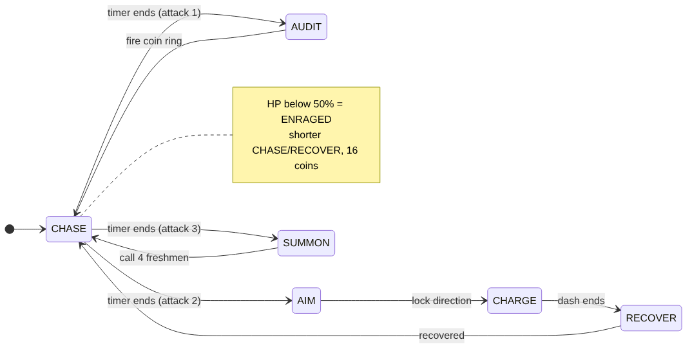

# Comsci Survivor: แนวทางนำเสนอระบบเชิง Computer Science

เอกสารนี้สรุป 3 ระบบที่ใช้โชว์ความรู้ CS พร้อมลำดับเดโมและตัวเลขสำหรับใส่สไลด์
รูปทั้งหมดอยู่ในโฟลเดอร์ `docs/`

---

## 1. Spatial Hashing: ลดการตรวจชนจาก O(n²) เหลือ ~O(n)

**ปัญหา**
ศัตรูเดินเข้าหาผู้เล่นพร้อมกันจนซ้อนทับกันเป็นก้อนเดียว จึงต้องมีระบบดันศัตรูให้แยกออกจากกัน (crowd separation)
วิธีตรงไปตรงมาคือนำศัตรูทุกตัวมาตรวจกับทุกตัว จำนวนครั้งที่ต้องตรวจคือ n(n−1)/2 ซึ่งเป็น O(n²)

**วิธีแก้**
แบ่งแผนที่เป็นตารางช่องละ 48 พิกเซล แล้วเก็บศัตรูแต่ละตัวไว้ใน dictionary ตามช่องของจุดศูนย์กลาง (`spatial.py`)
จากนั้นตรวจเฉพาะศัตรูในช่องเดียวกันและช่องข้างเคียง 4 ช่อง (ครึ่งหนึ่งของ 8 ช่องรอบตัว) ซึ่งครอบคลุมทุกคู่ที่อยู่ใกล้กันได้ครบ คู่ละครั้งเดียว โดยไม่ต้องใช้ set กันคู่ซ้ำ
- สร้างตาราง: O(n)
- ตรวจคู่: O(n·k) โดย k คือจำนวนศัตรูเฉลี่ยต่อช่อง ซึ่งคงที่เมื่อความหนาแน่นคงที่ จึงได้ ~O(n)
- ศัตรูที่ตัวใหญ่กว่าช่อง (บอส) เก็บแยกไว้อีกรายการ แล้วค้นหาแบบ bounding box รอบตัว และกำหนด `mass` ให้บอสถูกดันน้อยกว่าลูกน้อง

**ผล benchmark** (`python benchmarks/collision_benchmark.py`, ความหนาแน่นคงที่, ค่ามัธยฐาน 5 รอบ)

| ศัตรู | Naive (ms) | Spatial hash (ms) | เร็วขึ้น | จำนวนตรวจ (Naive) | จำนวนตรวจ (Hash) |
|---:|---:|---:|---:|---:|---:|
| 100 | 0.86 | 0.16 | 5.2× | 4,950 | 350 |
| 400 | 14.55 | 0.73 | 20.0× | 79,800 | 1,519 |
| 800 | 71.53 | 1.45 | 49.3× | 319,600 | 3,207 |
| 2,000 | 463.59 | 3.83 | 121× | 1,999,000 | 8,014 |

ตัวเลขข้างบนวัดบนเครื่องที่ใช้พัฒนา ก่อนนำเสนอให้รัน benchmark บนเครื่องของตัวเองใหม่

หนึ่งเฟรมที่ 60 FPS มีเวลา 16.7 ms วิธี Naive เกินงบนี้ตั้งแต่ประมาณ 400 ตัว ส่วน Spatial hash ยังใช้เวลาไม่ถึง 4 ms ที่ 2,000 ตัว

**เวอร์ชันแรกเทียบกับเวอร์ชันปรับปรุง:** เวอร์ชันแรกใส่ศัตรูลงทุกช่องที่ตัวทับ แล้วใช้ set กันคู่ซ้ำ ทดลองบนเครื่องจริงแล้วพบว่าเมื่อศัตรูอัดกันเป็นก้อนยังช้าอยู่ (ศัตรู 900 ตัว: 6.2 ms) จึงเปลี่ยนเป็นเก็บช่องเดียวตามจุดศูนย์กลาง ลดเหลือ 3.2 ms เรื่องนี้ใช้เล่าตอนนำเสนอได้ ว่าทีมวัดผล → หาจุดคอขวด → ปรับปรุงจริง

รูปประกอบ: `collision_benchmark.png`, `debug_hash.png`, `debug_naive.png`

**การทดสอบ** (`tests/test_spatial.py`)
ยืนยันว่า Spatial hash หาคู่ที่ชนกันได้ **ครบและตรงกับวิธี Naive ทุกคู่** ด้วยจำนวนการตรวจน้อยกว่าไม่ต่ำกว่า 20 เท่า

---

## 2. Boss AI แบบ Finite State Machine

บอส The Chief Auditor มีสถานะทั้งหมด 6 สถานะ (`accounting.py`, คลาส `BossBrain`)
ตารางการเปลี่ยนสถานะเก็บไว้เป็นข้อมูล (`TRANSITIONS`) ไม่ได้เขียนเป็น if-else ซ้อนกัน จึงวาดเป็นแผนภาพได้ตรงกับโค้ด

| สถานะ | สิ่งที่บอสทำ | สถานะถัดไป |
|---|---|---|
| CHASE | เดินไล่ผู้เล่น | เลือกท่าโจมตีถัดไปตามรอบ AUDIT → AIM → SUMMON |
| AUDIT | ตั้งท่าแล้วยิงเหรียญเป็นวง | CHASE |
| AIM | หยุดเล็งและแสดงเส้นแดงเตือน (telegraph) | CHARGE |
| CHARGE | พุ่งชนตามทิศที่ล็อกไว้ | RECOVER |
| RECOVER | ยืนพักให้ผู้เล่นมีจังหวะสวนกลับ | CHASE |
| SUMMON | เรียกหนุ่มบัญชีปี 1 มาช่วย | CHASE |

**ประเด็นที่ควรพูดตอนนำเสนอ**
- **ความยุติธรรมของเกม (game design):** ทุกท่าโจมตีมีจังหวะเตือนก่อน (wind-up และเส้นแดง) และบอสเลิกปรับทิศในช่วง 0.25 วินาทีสุดท้ายก่อนพุ่ง ผู้เล่นจึงหลบได้ทุกครั้ง
- **ENRAGED เป็นตัวปรับค่า ไม่ใช่สถานะใหม่:** เมื่อเลือดต่ำกว่า 50% เวลาของ CHASE และ RECOVER จะสั้นลง และวงเหรียญเพิ่มเป็น 16 ลูก โดยไม่ต้องเพิ่มสถานะให้ state machine ซับซ้อนขึ้น
- **ทดสอบได้:** `tests/test_accounting_stage.py` จำลองบอส 20 วินาที แล้วตรวจว่าลำดับสถานะตรงตามแผนภาพทุกขั้น

---

## 3. Debug Overlay (กด F3)

ใช้แสดงให้เห็นว่าทั้ง 2 ระบบข้างต้นทำงานอยู่จริงขณะเล่น

| แสดงอะไร | ความหมาย |
|---|---|
| FPS และ frame time | ประสิทธิภาพรวมของเกม |
| pair checks เทียบกับ n²/2 | จำนวนการตรวจชนที่ทำจริง เทียบกับจำนวนที่วิธี Naive ต้องทำ |
| separation ms และกราฟ | เวลาที่ใช้ตรวจชนในแต่ละเฟรม เส้นแดงคือขีด 16.7 ms |
| ช่องตารางสีส้ม | ช่องของ Spatial hash ที่มีศัตรูอยู่ ยิ่งสีเข้มยิ่งมีศัตรูมาก |
| วงกลมแดงรอบศัตรู | ขอบเขตที่ใช้ตรวจการชน |
| ป้ายเหนือหัวบอส และประวัติสถานะ | สถานะปัจจุบันของ FSM และสถานะที่ผ่านมา |

**ปุ่มลัด:** F3 เปิด/ปิด overlay, F2 สลับโหมด HASH/NAIVE, F4 Demo mode (ปิดอาวุธและเปิดอมตะ เพื่อให้ฝูงศัตรูไม่ถูกฆ่าระหว่างเดโม), F5 เพิ่มศัตรู 300 ตัว

---

## 4. Flow Field Pathfinding (BFS) และพฤติกรรมศัตรู

**ปัญหา**
ด่านบัญชีมีโต๊ะ ชั้นหนังสือ และตู้เอกสารเป็นสิ่งกีดขวาง ถ้าศัตรูเดินเป็นเส้นตรงเข้าหาผู้เล่น จะติดอยู่หลังโต๊ะ
ถ้าให้ศัตรูแต่ละตัวคำนวณ A* เอง ต้องค้นหา n ครั้งต่อเฟรม ซึ่งช้าเมื่อมีศัตรูหลายร้อยตัว

**วิธีแก้** (`pathfinding.py`)
- แบ่งพื้นที่รอบผู้เล่นเป็นตารางช่องละ 32 พิกเซล ขนาด 56×42 ช่อง แล้วทำ **BFS ครั้งเดียว** โดยเริ่มจากช่องที่ผู้เล่นยืนอยู่
- ทุกช่องจะได้ระยะทางที่สั้นที่สุดไปหาผู้เล่น และทิศทางไปยังช่องข้างเคียงที่ใกล้กว่า ศัตรูทุกตัวจึงแค่อ่านลูกศรของช่องที่ตัวเองยืนอยู่ ซึ่งเป็น O(1)
- สร้าง field ใหม่เฉพาะตอนที่ผู้เล่นเดินข้ามไปช่องใหม่ ใช้เวลาประมาณ 1–2 ms ต่อครั้ง
- ห้ามเดินตัดมุมแนวทแยง และขยายขอบสิ่งกีดขวางเผื่อขนาดตัวละคร ศัตรูจึงไม่เดินทะลุมุมโต๊ะ
- กด F3 จะเห็นลูกศรของ field และช่องสีแดงที่เป็นสิ่งกีดขวาง

**พฤติกรรมศัตรูที่ฉลาดขึ้น**

| ศัตรู | พฤติกรรม | แนวคิด |
|---|---|---|
| ทุกตัว | มีมุมเข้าหาเฉพาะตัว จึงเข้าล้อมจากหลายทิศ แทนการต่อแถวเป็นเส้นเดียว ใช้ flow field เฉพาะเมื่อมีสิ่งกีดขวางขวางทาง | steering |
| หนุ่มบัญชีปี 1 | ย่อตัว 0.28 วินาทีก่อน (เป็นสัญญาณเตือน) แล้วพุ่งใส่ด้วยความเร็ว 2.7 เท่า | state machine ขนาดเล็ก |
| สายเครื่องคิดเลข | รักษาระยะ และเดินวนด้านข้าง (strafe) ยิงดักทางโดยคำนวณจุดที่ผู้เล่นจะไปถึง (lead targeting) | ทำนายตำแหน่งจากความเร็ว |

## 5. อนิเมชันและฉาก (`animation.py`, `stage_art.py`)

- ตัวละครมีภาพเพียงเฟรมเดียว จึงสร้างการเคลื่อนไหวด้วยโค้ด (procedural animation): โยกตัวตามระยะที่เดิน, ยืดหดตัว, เงาใต้เท้า, กะพริบขาวตอนโดนตี, ค่อยๆ ปรากฏตอนเกิด, แตกเป็นเศษพิกเซลตอนตาย และตัวเลขดาเมจลอยขึ้น
- ภาพที่แปลงแล้วเก็บไว้ใน cache จึงวาดศัตรูหลายร้อยตัวได้โดยไม่ช้า
- แผนที่ไม่มีขอบเขต จึงวางของตกแต่งทีละ chunk ขนาด 640×640 โดยใช้ seed จากพิกัดของ chunk chunk เดิมจึงได้ผังเดิมทุกครั้ง โดยไม่ต้องเก็บข้อมูลไว้
- เรียงลำดับการวาดตามความลึก (depth sorting by y) ตัวละครจึงเดินผ่านหน้าหรือหลังโต๊ะได้ถูกต้อง

---

## ลำดับเดโมแนะนำ (ประมาณ 3 นาที)

1. รัน `python main.py --stage 2` แล้วกด **F3** พร้อมอธิบายแต่ละช่องบนจอสั้นๆ
2. กด **F4** เปิด Demo mode แล้วกด **F5** สามครั้งเพื่อให้มีศัตรูประมาณ 900 ตัว ชี้ให้ดูว่า pair checks มีแค่หลักพัน และ FPS ยังลื่น
3. กด **F2** สลับเป็น NAIVE ค่า pair checks จะกระโดดเป็นหลักแสน (900 ตัวประมาณ 400,000 ครั้ง), กราฟพุ่งเกินเส้นแดง และเกมกระตุกให้เห็นชัด จากนั้นกด F2 กลับเป็น HASH แล้วกด F4 ปิด Demo mode
4. ขึ้นสไลด์กราฟ benchmark เพื่อยืนยันผลด้วยตัวเลข
5. ปิด F4 แล้วเดินไปหลังแถวโต๊ะ ชี้ลูกศร flow field บนจอ (F3) ให้เห็นว่าศัตรูเดินอ้อมโต๊ะเข้ามาหา
6. รอให้บอสโผล่ (หรือเริ่มเดโมโดยเลื่อนเวลาไว้ใกล้ 2:30) แล้วชี้ป้ายสถานะ AIM → CHARGE → RECOVER พร้อมแผนภาพ FSM บนสไลด์
7. ปิดด้วยการรันเทสต์ `python -m unittest discover -s tests -v` ให้เห็นว่าทุกระบบมีเทสต์ยืนยัน

## คำถามที่อาจารย์อาจถาม

- **ทำไมใช้ช่องขนาด 48 พิกเซล?** วิธีตรวจช่องข้างเคียงจะถูกต้องเมื่อขนาดช่องไม่เล็กกว่าเส้นผ่านศูนย์กลางของศัตรูที่ใหญ่ที่สุด ศัตรูทั่วไปมีเส้นผ่านศูนย์กลางไม่เกิน 42 พิกเซล จึงใช้ 48 ถ้าช่องใหญ่กว่านี้ แต่ละช่องจะมีศัตรูมากจนต้องตรวจเยอะขึ้น ส่วนบอสที่ตัวใหญ่กว่าช่องแยกไปตรวจต่างหาก ปรับค่าได้ที่ `CELL_SIZE`
- **ทำไมไม่ใช้ Quadtree?** ศัตรูในเกมนี้ขนาดใกล้เคียงกันและกระจายตัวค่อนข้างสม่ำเสมอ Uniform grid จึงเขียนง่ายกว่าและเร็วกว่า ส่วน Quadtree จะได้เปรียบเมื่อวัตถุกระจุกตัวไม่สม่ำเสมอมาก
- **กรณีแย่ที่สุดคืออะไร?** ถ้าศัตรูทุกตัวอัดอยู่ในช่องเดียว จะกลับไปเป็น O(n²) แต่ระบบ separation จะดันศัตรูออกจากกัน ทำให้ความหนาแน่นถูกจำกัดอยู่เอง
